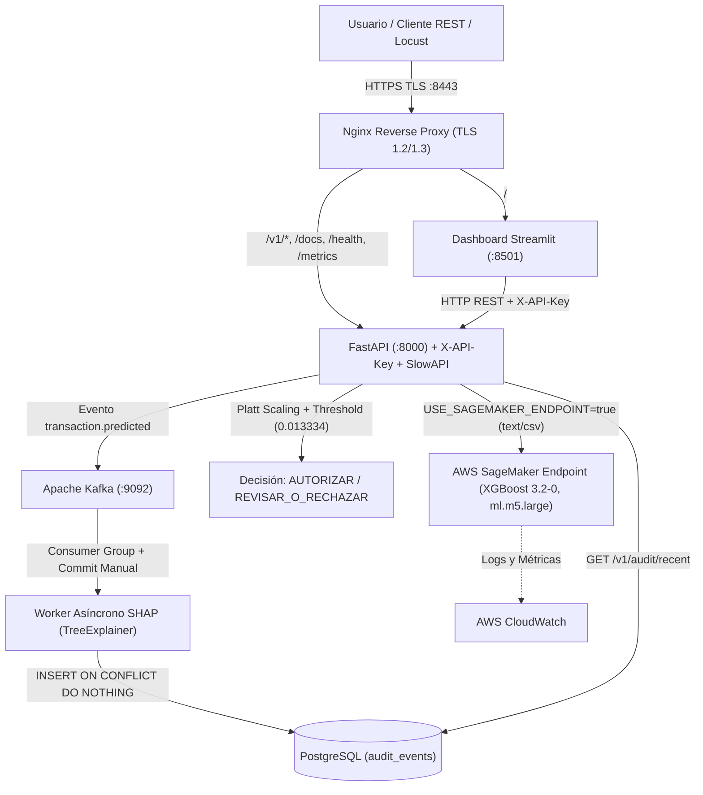
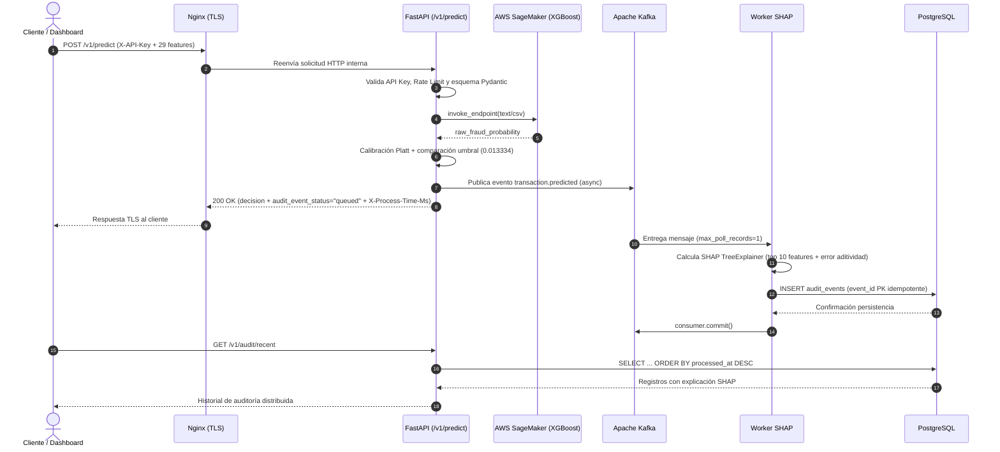

# Arquitectura y Flujo de Comunicación — PagoSeguro (EP3)

## 1. Arquitectura Desplegada (MVP EP3)

## 2. Diagrama de Secuencia (Flujo Completo en Tiempo Real)

## 3. Mapeo MVP Implementado vs Arquitectura Target Caso 3 (Oportunidades de Optimización)

| Aspecto | Implementación Actual (EP3) | Arquitectura Target Caso 3 | Brecha y Optimización Propuesta |
| :--- | :--- | :--- | :--- |
| **Inferencia Cloud** | AWS SageMaker `ml.m5.large` (1 instancia) + `configure_autoscaling.py` | EKS / SageMaker Multi-AZ (4–12 nodos `c6i.xlarge`) con HPA/Auto-Scaling | Activar mínimo 2 instancias Multi-AZ para HA `99.99%` y mover calibrador Platt al contenedor de inferencia para evitar roundtrips. |
| **Ingestion / Streaming** | Apache Kafka 1 nodo en Docker (`PLAINTEXT`) | Amazon MSK (3 brokers Multi-AZ, TLS + SASL/IAM) | Migrar broker a Amazon MSK con replicación factor 3 y cifrado en tránsito. |
| **Feature Store** | Variables precalculadas en payload (`V1..V28`, `Amount`) | Feast + Amazon ElastiCache Redis Multi-Región (`< 10 ms`) | Incorporar Redis para calcular agregaciones en ventana móvil (ej. monto últimos 5 min). |
| **Seguridad** | `X-API-Key`, `slowapi`, TLS en Nginx (`HTTPS :8443`) | mTLS interno, KMS CMK en reposo, IAM Least Privilege, masking PAN | Terminar TLS en ALB con ACM, rotar secretos con Secrets Manager y cifrar RDS/MSK con KMS. |
| **Observabilidad & MLOps** | Middleware latencia, `/metrics` Prometheus, script CloudWatch | Prometheus + Grafana + PagerDuty/Slack + MLflow + Drift detection | Desplegar alertas automatizadas sobre `P99 > 90 ms`, Data/Concept Drift y F1 en producción, más tracking MLflow. |

