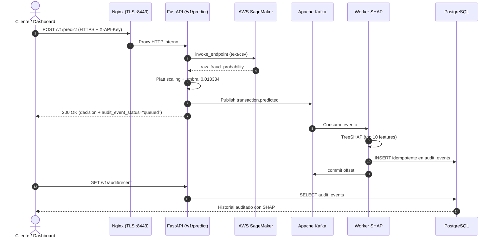

# Informe Técnico — Evaluación Parcial N°3 (ITY1102)
**Proyecto:** PagoSeguro — Sistema Integral de Detección de Fraude Financiero en Tiempo Real (Caso 3)  
**Archivo final sugerido:** `EP3_Equipo[N]_Apellidos.pdf` *(máximo / objetivo: 10 páginas)*  
**Equipo:** [COMPLETAR: Integrantes y Equipo N°]  
**Repositorio GitHub:** [COMPLETAR: URL del repositorio GitHub]  
**URLs Funcionales Desplegadas:**  
- **Modelo IA (AWS SageMaker Endpoint):** `pagoseguro-fraud-20261125-010808-1aa3` (`us-east-1`, `InService`)  
- **API REST / Swagger (HTTPS TLS):** [COMPLETAR: `https://<IP-EC2>:8443/docs` o `https://localhost:8443/docs`]  
- **Dashboard Interactivo (Streamlit):** [COMPLETAR: `https://<IP-EC2>:8443/` o `http://localhost:8501`]

---

## 1. Resumen Ejecutivo y Contexto Empresarial (Caso 3)

PagoSeguro es una fintech de pagos digitales que opera con 200.000 usuarios activos y 200.000 transacciones diarias, proyectando escalar a 1.000.000 de transacciones diarias (150 TPS promedio, picos de 1.000 TPS). Su motor previo basado en reglas estáticas generaba un 0,5% de fraude efectivo (\$500.000 USD/año en pérdidas) y un 40% de falsos positivos que bloqueaban clientes legítimos.

Para resolver esta problemática, se diseñó, entrenó y desplegó una arquitectura orientada a eventos (EDA) y microservicios que combina:
1. **Inferencia de Machine Learning en la nube** mediante **AWS SageMaker** (`XGBoost 3.2-0` en instancia `ml.m5.large`), complementada con calibración de probabilidades Platt (`LogisticRegression`) y optimización de umbral orientada a negocio (`0.013334`).
2. **API REST empresarial en FastAPI** con autenticación (`X-API-Key`), limitación de tasa (`slowapi`), proxy reverso con cifrado **TLS 1.2/1.3** (`Nginx`) y métricas de observabilidad (`/metrics`).
3. **Explicabilidad (XAI) asíncrona y auditoría distribuida** con **Apache Kafka**, un **Worker SHAP (`TreeExplainer`)** independiente y persistencia idempotente en **PostgreSQL**, visualizada en un **Dashboard Streamlit**.

---

## 2. Implementación y Despliegue del Modelo de IA (IE1, IE2)

### 2.1 Dataset, Entrenamiento, Calibración e Hiperparámetros
El desarrollo experimental se ejecutó en el notebook `notebooks/EP3_PagoSeguro_Deteccion_Fraude.ipynb` utilizando el dataset asignado **Credit Card Fraud Detection (`mlg-ulb/creditcardfraud`)** de Kaggle (284.807 transacciones, 31 columnas). Se excluyó `Time` y se utilizaron las **29 variables numéricas** `V1`–`V28` (componentes PCA anonimizadas) y `Amount`, manteniendo `Class` (`0 = Legítima`, `1 = Fraude`) como variable objetivo.

Los datos se dividieron de manera estratificada en entrenamiento, calibración (10%), validación (10%) y prueba (20%). Se entrenó un clasificador **`XGBClassifier`** (XGBoost `3.4.1`) con manejo de desbalance (`scale_pos_weight = 578.2644`) y los siguientes hiperparámetros principales registrados en `api/artifacts/model_metadata.json`:
- `objective`: `binary:logistic`, `eval_metric`: `aucpr`, `tree_method`: `hist`
- `n_estimators`: `400`, `max_depth`: `5`, `learning_rate`: `0.05`
- `subsample`: `0.8`, `colsample_bytree`: `0.8`, `reg_lambda`: `5`, `random_state`: `42`

Sobre la salida cruda del modelo se ajustó un calibrador **Platt scaling** (`LogisticRegression`, reduciendo el Brier score de validación de `0.0004896` a `0.0004692`). Posteriormente se seleccionó el umbral **`0.01333367`** maximizando $F_{0.5}$ sujeto a $\text{FPR} \le 5\%$ y $\text{Recall} \ge 80\%$ en validación.

### 2.2 Integración en Aplicación Empresarial e Interpretabilidad (XAI)
Para no penalizar la latencia síncrona de autorización, la inferencia online y la explicabilidad están desacopladas:
- **`POST /v1/predict`**: valida las 29 variables mediante Pydantic (`PredictionRequest`), invoca al endpoint de **AWS SageMaker** (cuando `USE_SAGEMAKER_ENDPOINT=true`), aplica el calibrador Platt y el umbral en `FraudModelService`, retorna `AUTORIZAR` o `REVISAR_O_RECHAZAR`, y publica el evento `transaction.predicted` en Kafka.
- **`POST /v1/explain`** y **Worker SHAP**: utilizan `shap.TreeExplainer(..., model_output="raw")` sobre el artefacto XGBoost para explicar la contribución log-odds de las variables más influyentes (ej. `V14`, `V10`, `V12`, `V4`) con verificación de aditividad (`additivity_error < 1e-3`).
- **Dashboard Streamlit (`dashboard/streamlit_app.py`)**: permite evaluar transacciones individuales, procesar lotes CSV (`data/sample_transactions.csv`) con métricas locales, visualizar gráficos de barras SHAP y auditar el historial distribuido Kafka + PostgreSQL.

### 2.3 Evidencias del Modelo Desplegado y Funcionando
- `[INSERTAR CAPTURA: evidencia_capturas/Captura de pantalla 2026-11-24 205725.png — Verificación describe_endpoint InService en SageMaker]`
- `[INSERTAR CAPTURA: evidencia_capturas/Captura de pantalla 2026-11-24 204943.png / 205016.png — Predicción TX-FRAUDE-001 y TX-LEGITIMA-001 vía SageMaker]`
- `[INSERTAR CAPTURA: evidencia_capturas/Captura de pantalla 2026-11-24 205108.png — Respuesta SHAP TreeExplainer en /v1/explain]`
- `[INSERTAR CAPTURA: evidencia_capturas/Captura de pantalla 2026-11-24 205810.png — Dashboard Streamlit mostrando predicción y gráfico SHAP]`

---

## 3. Plataforma AIaaS, Infraestructura y Análisis de Costos (IE4, IE5)

### 3.1 Configuración en AWS SageMaker e Infraestructura Operativa
El modelo nativo `xgboost_fraud_model.json` fue empaquetado como `xgboost-model` dentro de `model.tar.gz`, subido a Amazon S3 (`s3://pagoseguro-model-187035651158-us-east-1-17bfb532/...`) y desplegado mediante `sagemaker/deploy.py` usando el contenedor oficial `683313688378.dkr.ecr.us-east-1.amazonaws.com/sagemaker-xgboost:3.2-0` en una instancia **`ml.m5.large`** con `EnableNetworkIsolation=True`.

Para la gestión de escalabilidad y evidencias en AWS se incorporaron:
- **`sagemaker/configure_autoscaling.py`**: registra el objetivo escalable `sagemaker:variant:DesiredInstanceCount` (`MinCapacity=1`, `MaxCapacity=4`) con política `TargetTrackingScaling` basada en `SageMakerVariantInvocationsPerInstance` (`TargetValue=70.0`).
- **`sagemaker/export_cloudwatch_evidence.py`**: extrae métricas `Invocations`, `ModelLatency`, `OverheadLatency`, errores `4XX`/`5XX` y logs de `/aws/sagemaker/Endpoints/<endpoint>` desde Amazon CloudWatch.
- **Orquestación contenerizada (`docker-compose.yml`)**: integra `kafka` (`apache/kafka:3.9.1`), `postgres` (`postgres:16-alpine`), `api` (`FastAPI`), `worker` (`audit_worker.py`), `dashboard` (`Streamlit`) y `nginx` (proxy TLS `:8443`).

`[INSERTAR CAPTURA: Consola AWS CloudWatch / salida de export_cloudwatch_evidence.py con métricas del endpoint]`

### 3.2 Análisis de Costos AWS (MVP vs Arquitectura Target Caso 3)
*(Fuente detallada en `docs/analisis_costos.md`)*

| Escenario | Componentes Principales | Costo Mensual Estimado (USD) | Cumplimiento Presupuesto Caso 3 (\$3.000–\$5.000 USD/mes) |
| :--- | :--- | :---: | :--- |
| **MVP AWS Academy (EP3)** | SageMaker `ml.m5.large` + EC2 `t3.medium` + S3 + CloudWatch | ~\$118 USD/mes 24/7 *(o < \$10 USD en pruebas de 20h)* | Muy por debajo del presupuesto referencial; optimizado para laboratorio. |
| **Target Producción (Caso 3)** | 4–12 nodos `c6i.xlarge` (EKS/SageMaker) + Amazon MSK (3 brokers) + ElastiCache Redis Multi-AZ + RDS Aurora PostgreSQL + ALB/KMS | ~\$1.835 – \$3.180 USD/mes | Dentro del rango estimado (\$1.500–\$2.800 / techo \$3.000–\$5.000 USD/mes) frente a \$500.000 USD/año en pérdidas por fraude. |

---

## 4. Integración de Servicios y Seguridad (IE7)

### 4.1 Arquitectura de Comunicación Distribuida y APIs REST
La API expone documentación OpenAPI/Swagger en `/docs` con los endpoints:
- `GET /health` y `GET /model-info` (estado de modelo, backend SageMaker/local, Kafka, DB y umbral).
- `POST /v1/predict` y `POST /v1/predict/batch` (inferencia síncrona + publicación asíncrona en Kafka).
- `POST /v1/explain` (explicabilidad SHAP bajo demanda).
- `GET /v1/audit/recent` (consulta de auditorías procesadas en PostgreSQL).
- `GET /metrics` (métricas Prometheus: conteo HTTP, decisiones y cuantiles de latencia).

El flujo asíncrono sigue el patrón **Event-Driven Architecture (EDA)**: cada predicción en `/v1/predict` publica un evento JSON con `event_id` (UUID) al tópico `pagoseguro.transaction.predicted`. El servicio `worker/audit_worker.py` consume con `enable_auto_commit=False`, recalcula las contribuciones SHAP localmente, inserta de forma idempotente en `audit_events` (`ON CONFLICT (event_id) DO NOTHING`) y confirma el offset en Kafka solo tras persistir en PostgreSQL.

### 4.2 Seguridad Implementada
1. **Autenticación**: todos los endpoints de negocio (`/v1/*`) validan el encabezado `X-API-Key` mediante comparación en tiempo constante (`hmac.compare_digest`).
2. **Encriptación TLS**: el servicio `nginx` (`nginx/Dockerfile`, `nginx/nginx.conf`) expone tráfico **HTTPS con TLS 1.2 / TLS 1.3** en el puerto `8443`, protegiendo en tránsito tanto la API REST como el Dashboard Streamlit (incluyendo WebSockets).
3. **Rate Limiting**: implementado con `slowapi` (`Limiter` por IP) sobre `/v1/predict`, `/v1/explain` y `/v1/predict/batch`, configurable vía `RATE_LIMIT` (por defecto `60/minute`).
4. **Aislamiento y manejo de datos**: el dataset de Kaggle usa variables PCA anonimizadas (`V1`–`V28`) sin almacenar números de tarjeta (PAN), y el contenedor SageMaker corre con `EnableNetworkIsolation=True`.

### 4.3 Diagrama de Secuencia y Pruebas de Interoperabilidad
*(Incluir diagrama renderizado desde `docs/arquitectura_y_secuencia.md`)*

- `[INSERTAR CAPTURA: docker compose ps + logs del worker ("Auditoria completada") + /health con kafka_publisher_enabled=true y audit_database_configured=true]`
- `[INSERTAR CAPTURA: Dashboard pestaña Historial mostrando "Auditoria distribuida Kafka + PostgreSQL" con estado completed]`

---

## 5. Testing, Calidad y Rendimiento (IE10)

### 5.1 Pruebas Unitarias y de Integración (`pytest`)
Se implementaron **15 casos de prueba automatizados** (`tests/test_api_and_model.py` + `sagemaker/test_response_parser.py`), superando el mínimo de 10 exigido por la pauta. Ejecución verificada con `pytest`: **15 passed, 0 failed (100%)**.

| # | Caso de Prueba | Alcance | Resultado |
| :---: | :--- | :--- | :---: |
| 1 | `test_health_endpoint_ok` | Estado API, carga de modelo y header `X-Process-Time-Ms` | PASSED |
| 2 | `test_model_info_returns_29_features_and_threshold` | Contrato de 29 variables y umbral `0.013334` | PASSED |
| 3 | `test_predict_requires_valid_api_key` | Rechazo HTTP `401` sin clave o con clave inválida | PASSED |
| 4 | `test_predict_rejects_missing_or_extra_features` | Validación HTTP `422` por variables faltantes/desconocidas | PASSED |
| 5 | `test_predict_rejects_boolean_feature_value` | Validación estricta de tipos numéricos (`422`) | PASSED |
| 6 | `test_predict_legitimate_transaction_authorizes` | Clasificación correcta de `TX-LEGITIMA-001` (`AUTORIZAR`) | PASSED |
| 7 | `test_predict_fraudulent_transaction_flags_review` | Clasificación correcta de `TX-FRAUDE-001` (`REVISAR_O_RECHAZAR`) | PASSED |
| 8 | `test_predict_sagemaker_backend_invokes_endpoint_and_calibrates` | Integración SageMaker `invoke_endpoint` + calibración Platt | PASSED |
| 9 | `test_explain_endpoint_returns_shap_top_features` | Explicabilidad SHAP y error de aditividad `< 1e-3` | PASSED |
| 10 | `test_predict_batch_and_limits` | Inferencia por lotes y validación de límites (`422`) | PASSED |
| 11 | `test_kafka_publisher_and_worker_process_event` | Flujo integrado productor Kafka → `process_event` SHAP → repositorio | PASSED |
| 12 | `test_metrics_endpoint_and_rate_limiting` | Exposición `/metrics` Prometheus y bloqueo HTTP `429` | PASSED |
| 13–15 | `test_plain_csv`, `test_json_float`, `test_csv_multi_value` | Parseo de respuestas del contenedor XGBoost SageMaker | PASSED |

### 5.2 Pruebas de Carga y Métricas de Rendimiento (`Locust` + `/metrics`)
Se ejecutó una prueba de carga headless con **Locust 2.47.0** (`load_tests/locustfile.py`, 30 usuarios concurrentes, rampa 10 u/s, 15s, con backend local en 1 worker `uvicorn` y `RATE_LIMIT=10000/minute`):

| Endpoint / Métrica | Solicitudes | Errores | Throughput (req/s) | p50 (ms) | p95 (ms) | p99 (ms) |
| :--- | :---: | :---: | :---: | :---: | :---: | :---: |
| `POST /v1/predict` (cliente Locust — legítima) | 1.423 | 0 (0,00%) | 100,79 | 58 | 120 | 190 |
| `POST /v1/predict` (cliente Locust — fraude) | 405 | 0 (0,00%) | 28,69 | 59 | 120 | 160 |
| `GET /health` (cliente Locust) | 164 | 0 (0,00%) | 11,62 | 19 | 50 | 66 |
| **Agregado Locust** | **1.992** | **0 (0,00%)** | **141,10** | **55** | **120** | **180** |
| **Métrica interna servidor (`/metrics` en `/v1/predict`)** | **1.831** | **0 (0,00%)** | — | **49,05** | **97,71** | **136,95** |

> `[COMPLETAR SI SE EJECUTA CONTRA SAGEMAKER/EC2]: Agregar fila comparativa midiendo el mismo script locustfile.py apuntando a la instancia EC2 + endpoint SageMaker.`

### 5.3 Métricas del Modelo (Conjunto de Prueba Kaggle)
Evaluación en el 20% de prueba (56.962 transacciones; 98 fraudes reales):
- **Accuracy:** `99,76%` (`0.997612`)
- **Precision (fraude):** `41,04%` (`0.410377`)
- **Recall (fraude):** `88,78%` (`0.887755`)
- **F1-score (fraude):** `56,13%` (`0.561290`)
- **FPR (Falsos Positivos):** `0,22%` (`0.002198`, cumple objetivo `< 5%`, frente al `40%` previo)
- **ROC-AUC:** `97,68%` · **PR-AUC:** `87,38%`
- **Matriz de confusión:** `TN = 56.739`, `FP = 125`, `FN = 11`, `TP = 87` (monto fraudulento no detectado en test: `17,16%`, equivalente a `1.826,50` de `10.644,93` en la muestra).

### 5.4 Oportunidades de Optimización
1. **Latencia P99 y escalabilidad a 1.000 TPS:** con 1 worker local la mediana (`49 ms`) y `p95` (`97,7 ms`) cumplen `<= 100 ms`, pero `p99` alcanza `136,95 ms` en servidor (`180 ms` E2E). En producción se requiere ejecutar múltiples workers/réplicas en nodos compute-optimized (`c6i.xlarge`), habilitar el Auto-Scaling de SageMaker (`Min=2, Max=4` Multi-AZ) y eliminar el salto de red local desplegando la API en la misma VPC/región (`us-east-1`).
2. **Batching real hacia SageMaker y Pool PostgreSQL:** `predict_batch` actualmente invoca SageMaker transacción por transacción y `AuditRepository` abre una conexión por evento; incorporar envío batch al endpoint y un pool (`psycopg_pool`) mejorará el throughput sostenido.
3. **Componentes del Caso 3 para paso a producción:** incorporar **Redis / Feast** para cálculo de variables en ventana de 5 min (`< 10 ms`), migrar Kafka local a **Amazon MSK (3 nodos Multi-AZ con TLS/IAM)**, agregar **MLflow** para versionado/lineage formal, **Prometheus + Grafana** para alertas de *Data/Concept Drift*, y **KMS CMK + mTLS** para cumplimiento PCI-DSS Nivel 1.

---

## 6. Referencias (Formato APA)

- Amazon Web Services. (2025). *Amazon SageMaker Developer Guide: Deploy Models for Inference and Automatic Scaling*. AWS Documentation. https://docs.aws.amazon.com/sagemaker/
- Chen, T., & Guestrin, C. (2016). XGBoost: A Scalable Tree Boosting System. *Proceedings of the 22nd ACM SIGKDD International Conference on Knowledge Discovery and Data Mining*, 785–794. https://doi.org/10.1145/2939672.2939785
- Dal Pozzolo, A., Caelen, O., Johnson, R. A., & Bontempi, G. (2015). Calibrating probability with undersampling for unbalanced classification. *2015 IEEE Symposium Series on Computational Intelligence*, 159–166. *(Dataset Credit Card Fraud Detection `mlg-ulb`)*.
- Lundberg, S. M., & Lee, S.-I. (2017). A Unified Approach to Interpreting Model Predictions. *Advances in Neural Information Processing Systems (NeurIPS)*, 30, 4765–4774.

---

## 7. Declaración de Uso de Inteligencia Artificial

En el desarrollo de este proyecto se utilizaron herramientas de asistencia basadas en Inteligencia Artificial Generativa como apoyo para la estructuración de código boilerplate (FastAPI, worker Kafka, scripts de despliegue SageMaker, pruebas automatizadas con `pytest`/`Locust`) y para la revisión y redacción técnica del presente informe. Todas las decisiones de arquitectura, entrenamiento del modelo, ejecución de pruebas, despliegue en AWS SageMaker y validación de resultados fueron revisadas, ejecutadas y verificadas por los integrantes del equipo, quienes asumen la responsabilidad íntegra sobre el contenido entregado.

